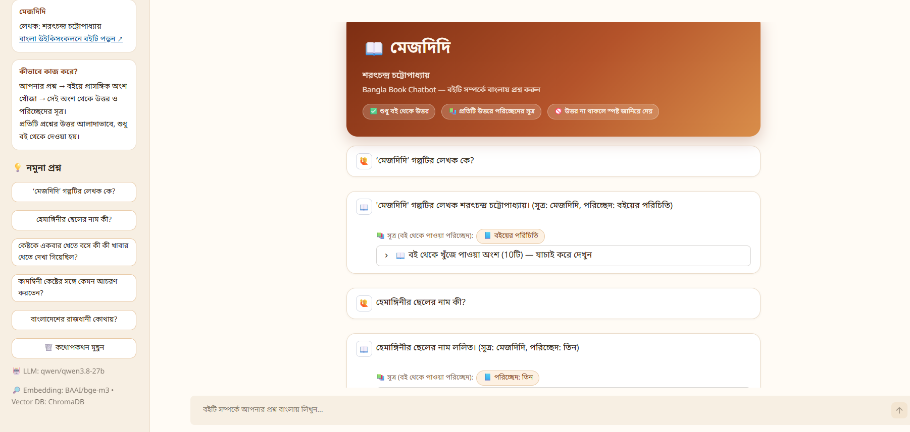
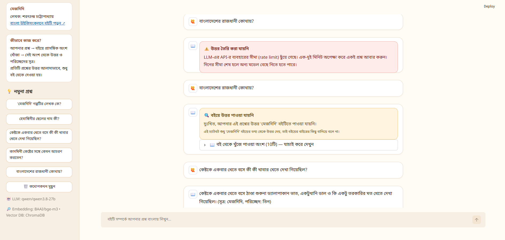
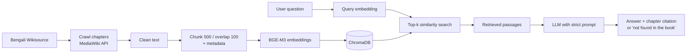

# 📖 Bangla Knowledge Base Chatbot (RAG + Vector DB)

A Retrieval-Augmented Generation (RAG) chatbot that answers questions about the Bangla novel **মেজদিদি** by
**শরৎচন্দ্র চট্টোপাধ্যায়** — **only from the book itself**, with a chapter citation for every answer. If the answer
is not in the book, the chatbot says so clearly instead of making something up.


---

## 📸 Screenshots

**Answers with chapter citations and the retrieved book passages**



**Out-of-book question and friendly error handling (rate-limit message and "not found in the book")**



---

## 📚 Book Information

| | |
|---|---|
| **Book title** | মেজদিদি (Mejdidi) |
| **Author** | শরৎচন্দ্র চট্টোপাধ্যায় (Sarat Chandra Chattopadhyay) |
| **Bengali Wikisource link** | [মেজদিদি on Bengali Wikisource](<https://bn.wikisource.org/wiki/%E0%A6%AE%E0%A7%87%E0%A6%9C%E0%A6%A6%E0%A6%BF%E0%A6%A6%E0%A6%BF_(%E0%A6%B6%E0%A6%B0%E0%A7%8E%E0%A6%9A%E0%A6%A8%E0%A7%8D%E0%A6%A6%E0%A7%8D%E0%A6%B0_%E0%A6%9A%E0%A6%9F%E0%A7%8D%E0%A6%9F%E0%A7%8B%E0%A6%AA%E0%A6%BE%E0%A6%A7%E0%A7%8D%E0%A6%AF%E0%A6%BE%E0%A6%AF%E0%A6%BC,_%E0%A7%A7%E0%A7%AF%E0%A7%AC%E0%A7%A9)/%E0%A6%AE%E0%A7%87%E0%A6%9C%E0%A6%A6%E0%A6%BF%E0%A6%A6%E0%A6%BF>) |
| **Chapters ingested** | 8 (এক, দুই, তিন, চার, পাঁচ, ছয়, সাত, আট) |
| **Text size** | ≈ 49,000 characters |

**Brief description:** *মেজদিদি* is a classic Bengali prose story about a boy named Kesto, who comes to live with his
elder half-sister Kadambini, and about the kindness of Hemangini (the "Mejdidi"), who cares for him while the
household tensions grow around him. The book text is already available in clean digital form on Bengali Wikisource
(no OCR needed).

---

## ✨ Key Features

- **Answers only from the book** — a strict prompt, `temperature=0` and no chat memory keep every answer grounded in the retrieved passages.
- **Chapter citations on every answer** — shown in the answer text *and* as clickable chips linking to the Wikisource chapter.
- **Honest "not found" behaviour** — questions outside the book get a fixed Bangla reply instead of a made-up answer.
- **Full-book ingestion** — all 8 chapter pages are crawled through the official MediaWiki API (not only the main page).
- **Multilingual semantic search** — BGE-M3 embeddings understand Bangla, including the old literary style (সাধু ভাষা) of the book.
- **Verify-it-yourself panel** — an expandable "retrieved passages" section shows exactly which book excerpts the answer was based on.
- **Beautiful, mobile-friendly Streamlit UI** — sample questions, hero banner, clear error cards.
- **Robust against API problems** — automatic retries on rate limits, empty-answer retry, and friendly error messages.
- **Works with any OpenAI-compatible LLM** — switch models by editing one line in `.env`.

---

## 🌍 Real-Life Impact & Applications

- **Bangla literature education:** students can quickly find who a character is, what happened in a scene, and in which chapter — with a source to check.
- **Exam preparation and revision:** instead of re-reading a whole book, learners get quick, referenced answers.
- **Support for a low-resource language:** shows that modern multilingual models can work well on classical Bangla text.
- **Research and teaching aid:** teachers and researchers can verify claims using the cited chapter and the retrieved passages.
- **Digital libraries & Wikisource projects:** the same pipeline can be pointed at any other prose book on Wikisource (history books, novels) by changing the book URL.
- **Trustworthy AI example:** demonstrates how RAG reduces hallucination by forcing answers to come from retrievable, citable sources.
- **Accessibility:** a conversational interface makes long Bangla texts easier to explore for readers who prefer asking questions over searching pages.

---

## 🛠️ Technologies Used

| Area | Technology |
|------|------------|
| Language | Python 3.11 |
| RAG framework | LangChain (`langchain-core`, `langchain-text-splitters`, `langchain-chroma`, `langchain-huggingface`, `langchain-openai`) |
| Embedding model | [`BAAI/bge-m3`](https://huggingface.co/BAAI/bge-m3) via `sentence-transformers` (PyTorch, CPU) |
| Vector database | ChromaDB (persistent, local) |
| LLM | Any OpenAI-compatible chat model (tested with `qwen/qwen3.8-27b` on Groq's free API) |
| Data collection | `requests` + MediaWiki API (Bengali Wikisource), `BeautifulSoup4` for HTML cleaning |
| User interface | Streamlit (custom CSS theme) |
| Configuration | `python-dotenv` |

---

## 🧭 Project Structure

```
Bangla_Chatbot/
├── src/
│   ├── ingest.py        # Crawl -> clean -> chunk -> embed -> store in ChromaDB
│   ├── retriever.py     # LangChain retriever on top of ChromaDB
│   ├── rag_chain.py     # Prompt + LLM + citations (the RAG pipeline)
│   ├── main.py          # Command-line chatbot
│   └── app.py           # Streamlit web interface
├── .streamlit/
│   └── config.toml      # UI theme and Streamlit settings
├── images/              # Screenshots used in this README
├── TEST_QUESTIONS.md    # 10 test questions with expected answers
├── requirements.txt
├── .env         # Template for your private .env file
├── .gitignore
├── data/                # (generated) cleaned chapter text files
└── chroma_store/        # (generated) vector database
```

`data/` and `chroma_store/` are created by `ingest.py` and are not stored in the repository.

---

## 🚀 Setup & Running Instructions

### Requirements

- **Python 3.10 or newer** (developed and tested on **Python 3.11**)
- Internet connection (to crawl Wikisource, download the embedding model, and call the LLM API)
- About **3 GB** of free disk space (the BGE-M3 model is ≈ 2.3 GB) and **8 GB RAM** recommended
- A free API key from an OpenAI-compatible provider, e.g. [Groq](https://console.groq.com)

### 1. Clone the repository

```bash
git clone https://github.com/soumit02/Bangla-Knowledge-Base-Chatbot.git
cd Bangla-Knowledge-Base-Chatbot
```

### 2. Create and activate a virtual environment

**Windows (PowerShell):**
```powershell
python -m venv venv
.\venv\Scripts\Activate.ps1
```

**macOS / Linux:**
```bash
python3 -m venv venv
source venv/bin/activate
```

### 3. Install dependencies

```bash
pip install -r requirements.txt
```

### 4. Configure your API key

Fill in your own values in `.env`:

```env
GROQ_API_KEY=your_api_key_here
BASE_URL=https://api.groq.com/openai/v1
MODEL_NAME=your_model_name_here
```

> 🔒 `.env` is listed in `.gitignore`. Never commit your real API key.

### 5. Build the knowledge base (run once)

```bash
cd src
python ingest.py
```

This crawls all 8 chapters, cleans and chunks the text, creates embeddings and saves them in `chroma_store/`.
The first run downloads the embedding model (≈ 2.3 GB) — please be patient. You should see:

```
Found 8 chapters in 'মেজদিদি'
...
Done! Stored 139 vectors in ChromaDB.
```

### 6. Run the chatbot

**Web interface (recommended)** — run from the **project root**:

```bash
cd ..
streamlit run src/app.py
```

The app opens at `http://localhost:8501`.

**Command-line version** — run from the `src` folder:

```bash
python main.py
```

---

## 🔬 Technical Details

| Item | Choice |
|------|--------|
| **Embedding model** | `BAAI/bge-m3` (normalized embeddings, cosine-style similarity) |
| **Chunk size** | 500 characters |
| **Chunk overlap** | 100 characters |
| **Splitter** | `RecursiveCharacterTextSplitter` with separators `\n\n`, `\n`, `। `, `।`, `? `, `! `, space |
| **Vector database** | ChromaDB (persistent, collection `bangla_book_rag`) |
| **Retriever** | LangChain `VectorStoreRetriever`, similarity search, **k = 10** (configurable via `RETRIEVE_K` in `.env`) |
| **LLM** | Any OpenAI-compatible chat model set in `.env`; tested with `qwen/qwen3.8-27b` (Groq), `temperature = 0` |
| **Total chunks** | ≈ 138 story chunks + 1 "book info" chunk = 139 vectors |

### Why BGE-M3?

- It is a **multilingual** model covering 100+ languages, **including Bengali**, so Bangla questions and Bangla passages live in the same vector space.
- It is trained specifically for **question → passage retrieval**, which is exactly this task. (A general sentence-similarity model, `paraphrase-multilingual-MiniLM`, was tried first and retrieved the wrong passages much more often.)
- It handles long inputs (up to 8192 tokens), so 500-character Bangla chunks are never truncated. The smaller MiniLM model only reads 128 tokens.
- It copes reasonably well with the book's old literary Bangla (e.g. *করিলেন*, *খাইয়া*) even when questions are asked in modern Bangla (*করলেন*, *খেয়ে*).

### Chunking choices

- **500 characters** is roughly a few sentences or a short exchange of dialogue — small enough that an embedding captures one idea, large enough to keep the surrounding context.
- **100-character overlap (20 %)** prevents an answer from being cut in half at a chunk boundary.
- The splitter prefers to break at paragraph → line → Bangla full stop (`।`) → `?`/`!` → space, so chunks end at natural sentence boundaries.

### Preprocessing approach

1. Chapter pages are fetched through the **MediaWiki API** (`list=allpages` to discover every chapter, `action=parse` to get its rendered text).
2. Navigation, header/footer templates and page numbers are removed from the HTML.
3. Text cleaning: zero-width and non-breaking spaces removed, footnote markers like `[১]` removed, stand-alone page numbers removed, repeated spaces and blank lines collapsed, Unicode normalized (NFC).
4. Very short fragments (< 40 characters) are dropped.
5. A small **"book info" chunk** (book name, author, number of chapters) is added so questions such as "Who wrote it?" can be answered.

**Metadata stored with every chunk:** book name, author, chapter name, section name, source URL, chunk index.

---

## 🔄 RAG Pipeline

```
Wikisource → Crawling → Cleaning → Chunking → Embeddings → Vector DB → Retrieval → LLM → Answer + Citation
```



**Step by step**

1. **Ingestion (`ingest.py`, run once):** crawl all chapters → clean → chunk → embed with BGE-M3 → store in ChromaDB.
2. **Question:** the user asks a question in Bangla (Streamlit UI or CLI).
3. **Query embedding:** the question is embedded with the same BGE-M3 model.
4. **Vector search:** ChromaDB returns the 10 most similar book passages (with their metadata).
5. **Context building:** the passages are formatted with `[Book | Chapter | Section | URL]` headers.
6. **LLM answer:** the LLM receives the passages and a strict prompt: answer **only** from the context, cite the chapter, never guess names or relationships, and reply with a fixed sentence if the answer is not present.
7. **Output:** answer text + clickable chapter citations + the retrieved passages for verification.

### How hallucination is reduced

- Strict system prompt: answer only from the retrieved context; names, ages and relationships must be stated explicitly.
- `temperature = 0` for deterministic answers.
- **No chat memory** — each question is answered independently, so earlier answers can never leak into later ones.
- A fixed "not found" sentence is returned whenever the LLM reports that the answer is absent.
- Citation chips only show chapters that the answer actually mentions.

---

## ✅ Test Questions

10 test questions (including one that is **not** answerable from the book) with expected answers and source chapters are in
**[TEST_QUESTIONS.md](TEST_QUESTIONS.md)**.

---

## ⚠️ Known Limitations

- **Relationships that are never stated directly.** For example, the book never says "Kadambini's son is Panchugopal" in one sentence, so asking *"কাদম্বিনীর ছেলের নাম কী?"* returns "not found". The chatbot is deliberately strict instead of guessing.
- **Character mix-ups.** Smaller LLMs sometimes confuse characters in a story with many relatives; a stronger model reduces this.
- **Free API limits.** Free LLM plans have per-minute and per-day token limits; the app retries automatically and shows a clear message when the limit is hit.
- **Large first download.** The BGE-M3 model is ≈ 2.3 GB and only downloads once.
- **Old literary Bangla.** The book is written in *সাধু ভাষা*, which can make semantic matching harder than with modern text.

---

## 🧰 Troubleshooting

| Problem | Explanation / Fix |
|---------|-------------------|
| `WinError 4551 ... Application Control policy has blocked ... torch_python.dll` (Windows) | Windows Smart App Control / policy is blocking PyTorch. Turn off Smart App Control (Windows Security → App & browser control) or reinstall the CPU build: `pip install torch --index-url https://download.pytorch.org/whl/cpu`. |
| `OpenAIRateLimitError` / "rate limit reached" | Your free API plan's limit was reached. Wait 1–2 minutes and ask again, set `RETRIEVE_K=6` in `.env`, or switch `MODEL_NAME`. |
| "Vector store not found" | Run `cd src && python ingest.py` first. |
| `MODEL_NAME not found` / `API key not found` | Check that `.env` exists in the project root and contains `GROQ_API_KEY`, `BASE_URL` and `MODEL_NAME`. |
| `torchvision` traceback in the terminal | Harmless message from Streamlit's file watcher; it is disabled in `.streamlit/config.toml`. |

---

## 👤 Author

**Your Name** — *Soumit Dey*

---

## 🙏 Acknowledgements

- The book text comes from **Bengali Wikisource** and is fetched at ingestion time; it is not redistributed in this repository.
- [BAAI](https://huggingface.co/BAAI/bge-m3) for the BGE-M3 embedding model.
- LangChain, ChromaDB, Streamlit and Groq for the tooling.